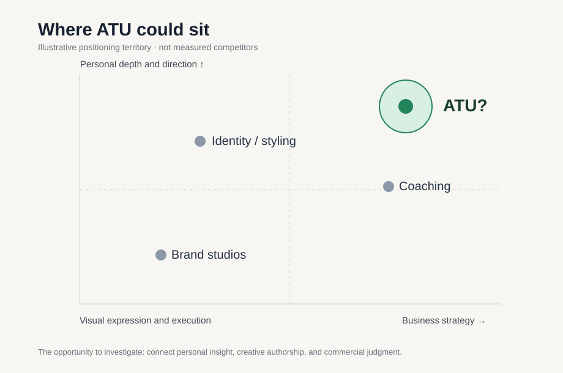

# Where ATU could sit

*Exploratory strategy · 2026-11-19 · No definitive category or offer chosen.*

## The underlying proposition

**ATU helps someone see the advantage already present in who they are, understand where it can take them, and express it in consequential choices.**

This comes from three forms of judgment:
1. **Personal depth** — attentive inquiry into values, desires, motivations, contradictions, and the gap between external success and internal direction.
2. **Creative direction** — style, visual taste, language, cultural references, storytelling without fabrication, and knowing when to bring in the right creative people.
3. **Commercial perspective** — opportunities, positioning, audiences, relationships, businesses, and the ability to move a promising idea toward reality.

Neither brand decoration nor therapy is the center. They may be adjacent disciplines; ATU's proposed value is the **connection between insight, expression, and action**.

## Market map

[Open the SVG by itself](positioning-map.svg).

The graph is conceptual, not a measured competitor score. Horizontal movement indicates greater involvement in business and strategic decisions; vertical movement indicates deeper involvement with the person's values and sense of direction. Conventional brand studios, coaches and identity practitioners are **illustrative archetypes**, not factual assessments of individual firms.

## Words to explore, not slogans to settle

| Territory | How to explain it | Risk |
| --- | --- | --- |
| **Personal direction** | A thoughtful outside perspective on who you are and what to do next | Too vague without concrete examples |
| **Creative confidant** | Someone who knows you well enough to challenge your choices and shape their expression | May sound decorative or overly intimate |
| **The advantage adviser** | Identify and develop the advantage no one else can replicate | Can lapse into self-flattery |
| **Personal strategy & creative direction** | Personal judgment translated into direction, style and action | Sounds like another professional service |
| **An eye on your next chapter** | A relationship for people with achievements who are reconsidering what comes next | Risks narrowing the work to reinvention |
| **Atú — o chestiune de caracter** | An editorial proposition around character, discernment and choice | Could be confused with a moral judgment |

Possible explanatory language (not approved):
- *Îți înțeleg direcția, văd posibilitățile și te ajut să le dai formă.*
- *Perspectivă pentru ce urmează.*
- *O relație de lucru în care ideile bune devin alegeri mai bune.*
- *Ai ajuns departe. Ce urmează?* (strong content hook, not necessarily the company's tagline)
- *O chestiune de caracter.* (editorial proposition, not necessarily the service definition)

**Do not revive “Atuul tău ești tu” as the default.** The pun felt corny and self-flattering. Avoid coaching clichés and promises of fame or follower numbers.

## What ATU might be to someone

A trusted independent perspective who:
- Notices patterns and strengths the person has normalized.
- Challenges assumptions and clarifies the questions worth asking.
- Sees where personal identity, public expression and business opportunities meet.
- Develops a credible creative direction rather than inventing a persona.
- Connects them to suitable photographers, designers, strategists or specialist practitioners when useful.
- Retains context across conversations and helps turn decisions into movement.

This isn't yet a package or a guarantee of results. The client has agency; the relationship must be clear about responsibility, scope, boundaries and access.

## Separating ATU from adjacent categories

| Typical category | Primary job | What ATU could add |
| --- | --- | --- |
| Brand studio | Brand identity, visual systems, campaigns | First work out the human and strategic direction worth expressing |
| Image consultant / stylist | Appearance and public presentation | Connect presentation to values, decisions and broader ambitions |
| Executive coach | Reflection, leadership and behavioral development | Bring stronger commercial and creative authorship |
| Business consultant | Market, growth and operational choices | Account for a person's character, taste and desired life |
| Content agency | Cadence, reach and social publishing | Develop an authentic point of view before content production |

These are category patterns, not claims that any specific provider lacks depth.

## The communications model

**Publication → reputation → relationship → private proposal.**

- **Instagram:** the publication. Portraits, observations, visual essays, cultural references, good questions, creative examples, personal moments, interviews. A point of view, not a continuous pitch.
- **atu.studio:** a beautiful business card. One memorable thought, minimal context, contact. No heavy services funnel.
- **Conversation:** the human fit. Begin with what the other person actually wants.
- **Engagement:** designed later, around a real goal and working relationship.

## Questions worth testing

1. What kind of successful person would pay for outside *judgment*, not just content or design?
2. What event triggers the need: reinvention, visibility, expansion, a new chapter, reputation or personal misalignment?
3. Does the client primarily buy direction, access to talent, continuity, implementation, or all of these?
4. What proof would establish credibility without borrowing social status?
5. What is a sustainable relationship at a relaxed, self-directed pace?
6. Could first case studies come from an experiment with ATU's founder, without treating personal revenue goals as the client promise?
7. How do we explain boundaries between advisory work, coaching and licensed mental-health services?

## Sources and status

Project rationale: private Beltechi Brain `projects/atu/README.md` and `writing.md`, as of 2026-11-19. The competitive interpretation is ATU research, not a validated market conclusion. See [competition research](../research/landscape-and-competitors.md).
